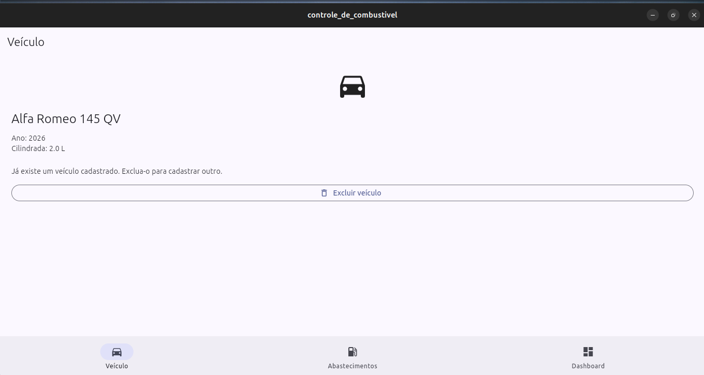
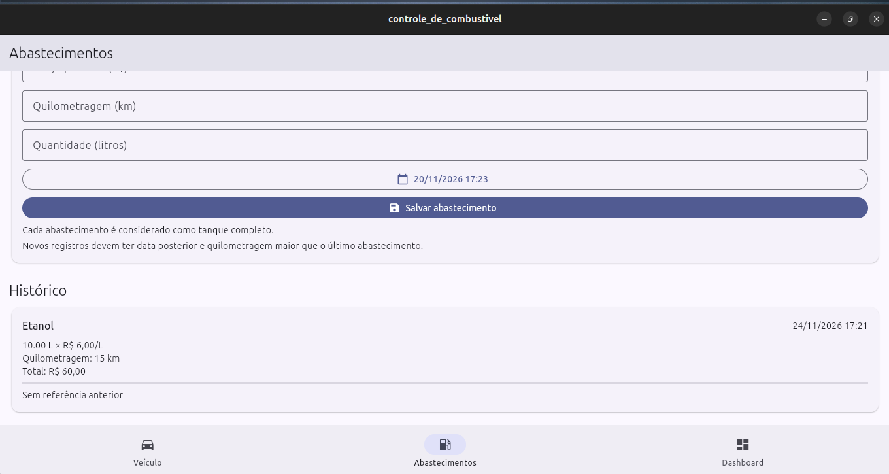
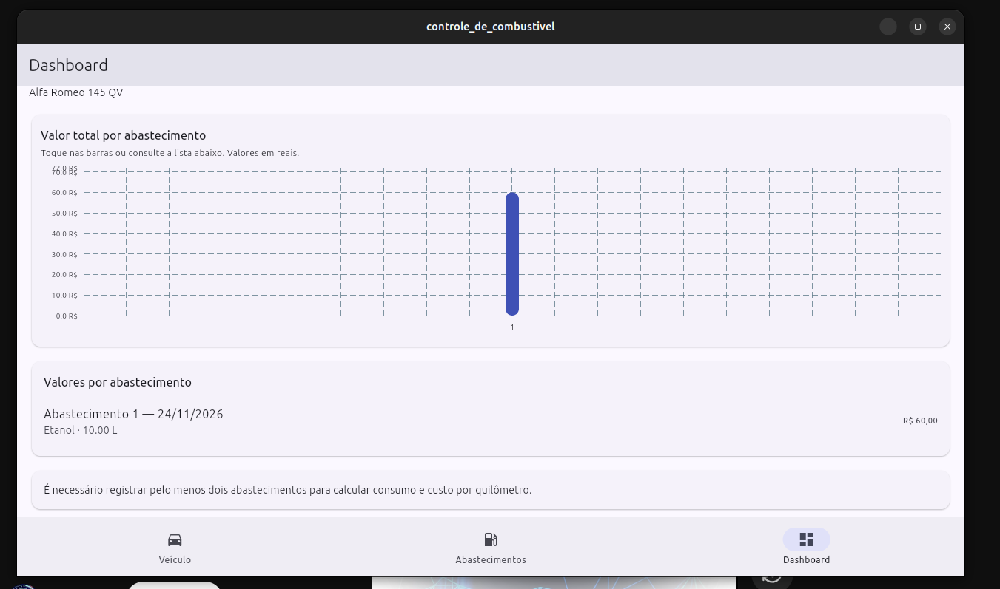

# Controle de gastos com combustível

Atividade da disciplina **Programação para Dispositivos Móveis II**, do professor **Arley**.

Autor: **Vinícius Lemes dos Santos**

## Descrição

O Controle de gastos com combustível é um aplicativo Flutter para acompanhar os gastos de um veículo. A aplicação permite cadastrar um único veículo, registrar abastecimentos e consultar indicadores de valor, consumo e custo por quilômetro.

O veículo possui marca, modelo, ano e cilindrada. As marcas e os modelos são consultados pela BrasilAPI, e os modelos carregados correspondem à marca escolhida. Os abastecimentos registram combustível, preço por litro, quilometragem, quantidade de litros e data/horário.

Os dados são persistidos localmente em JSON. Excluir o veículo exige confirmação e remove também os abastecimentos associados.

## Funcionalidades

- Cadastro de um veículo por vez.
- Consulta de marcas e modelos pela BrasilAPI FIPE.
- Registro de etanol, gasolina ou diesel.
- Cálculo do valor total de cada abastecimento.
- Persistência local do veículo e dos abastecimentos.
- Dashboard com valores, consumo em km/L e custo em R$/km.
- Restrição de novos abastecimentos em ordem cronológica.
- Exclusão do veículo com remoção dos abastecimentos relacionados.

Todos os abastecimentos são considerados como tanque completo.

## Requisitos

- Flutter instalado e configurado no PATH.
- Dart incluído na instalação do Flutter.
- Dispositivo ou emulador compatível com Flutter.
- Acesso à internet para consultar marcas e modelos.

## Execução

Na pasta do projeto, execute:

```bash
flutter pub get
flutter run
```

Para verificar o projeto:

```bash
dart format lib test
flutter analyze
flutter test
```

Para gerar um APK de depuração, com o Android SDK configurado:

```bash
flutter build apk --debug
```

## API e bibliotecas

O cadastro do veículo utiliza a [BrasilAPI FIPE](https://brasilapi.com.br/docs):

- Marcas de carros: `GET https://brasilapi.com.br/api/fipe/marcas/v1/carros`
- Modelos por marca: `GET https://brasilapi.com.br/api/fipe/veiculos/v1/carros/{codigoDaMarca}`

Bibliotecas adotadas:

- `http`: chamadas HTTP para a BrasilAPI.
- `shared_preferences`: armazenamento local dos dados em JSON.
- `fl_chart`: gráficos de valores, consumo e custo por quilômetro.
- `flutter_test`: testes unitários das fórmulas.

O projeto não utiliza backend próprio, autenticação, Firebase ou banco remoto.

## Fórmulas

- **Total** = preço por litro × litros.
- **Distância** = quilometragem atual − quilometragem anterior.
- **Consumo** = distância ÷ litros do abastecimento atual.
- **Custo por km** = total do abastecimento atual ÷ distância.

O primeiro abastecimento aparece no histórico de valores, mas serve apenas como referência. Ele não apresenta km/L nem R$/km. Esses indicadores começam no segundo abastecimento, usando os litros e o total do abastecimento atual.

Novos abastecimentos só podem ser registrados quando a data/horário forem posteriores e a quilometragem for maior que a do último registro.

## Organização do código

- `lib/models`: modelos de veículo e abastecimento.
- `lib/services`: API, persistência e funções de cálculo.
- `lib/screens`: telas de veículo, abastecimentos e dashboard.
- `test`: testes unitários.
- `android`: estrutura Android do projeto.

## Capturas de tela

As capturas abaixo foram feitas durante a execução do aplicativo e estão incluídas
no projeto:

### Veículo

Cadastro e visualização do veículo cadastrado:



### Abastecimentos

Registro e histórico de abastecimentos, com valor total e indicação de tanque
completo:



### Dashboard

Dashboard com o histórico de valores e os indicadores disponíveis:


